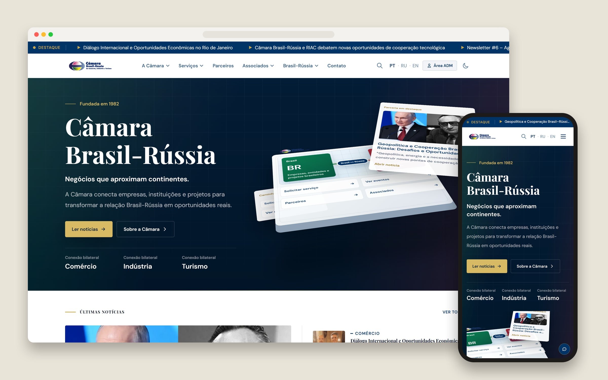
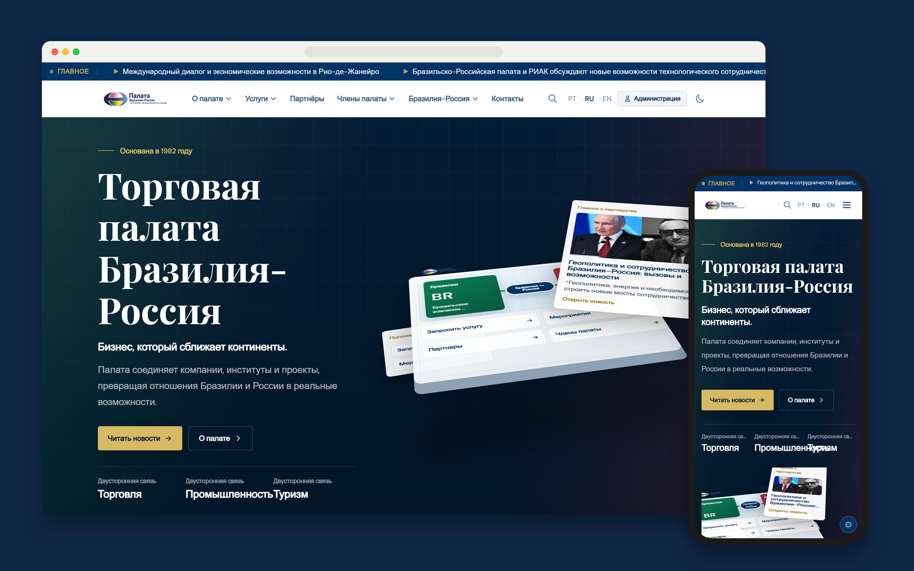
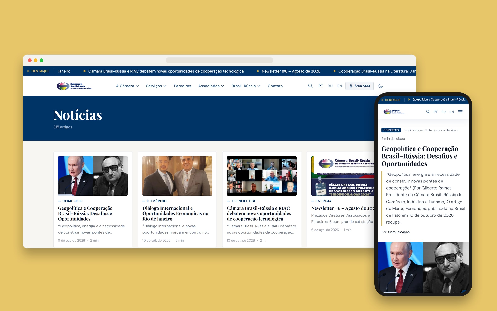
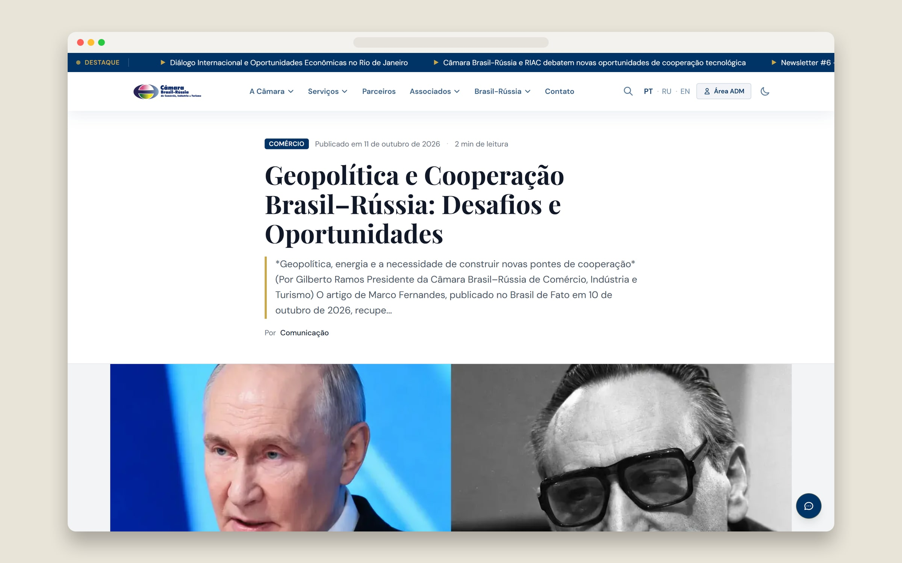
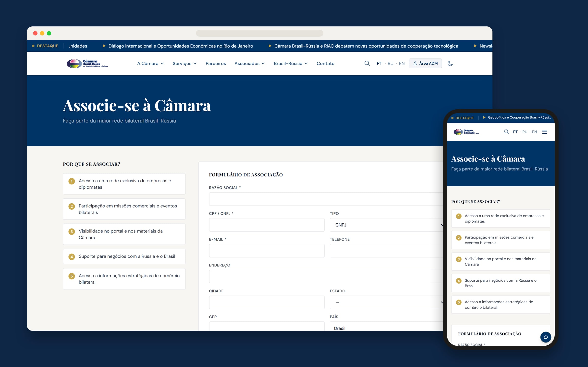
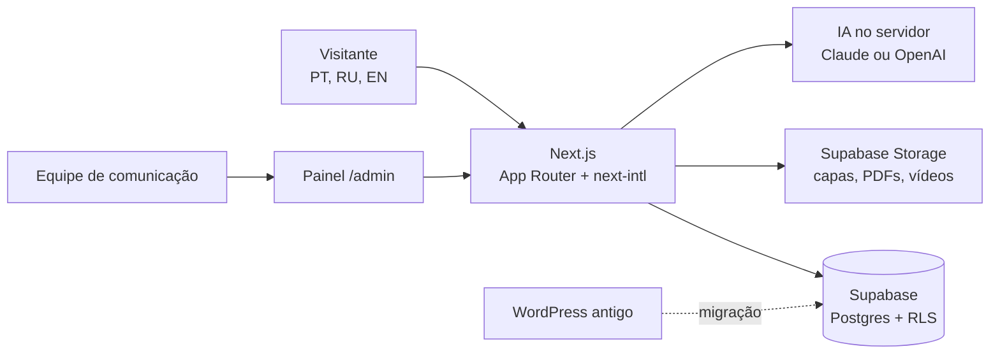

# Câmara Brasil-Rússia: portal trilíngue com redação assistida por IA

A Câmara de Comércio, Indústria e Turismo Brasil-Rússia existe desde 1982 e aproxima empresas e instituições dos dois países. O site antigo era um WordPress com anos de notícias acumuladas. Fiz um portal novo em Next.js, em português, russo e inglês, com um painel em que a equipe de comunicação cola o texto bruto e sai com o artigo pronto nas três línguas.

> Repositório vitrine. O código é da Câmara e fica num repositório privado.

## Telas

O site inteiro existe em três línguas, com rotas próprias (`/pt`, `/ru`, `/en`). Menu, títulos, botões e conteúdo mudam juntos.

As notícias do WordPress vieram para o banco novo, com categoria, data e imagem de capa. Hoje o portal tem 315 artigos.

| Artigo | Pedido de associação |
|---|---|
|  |  |

## Arquitetura

O front é Next.js com App Router, React 19 e Tailwind 4. As traduções da interface ficam no `next-intl`, e o conteúdo de cada artigo tem colunas próprias por língua no banco (`title_pt`, `title_ru`, `title_en` e assim por diante). O banco é Supabase com Row Level Security: o público só lê o que está publicado e só pode inserir onde faz sentido (newsletter, contador de leitura, formulários). Tudo o que é de escrita no painel passa por rotas do servidor, que conferem a sessão antes de usar a chave de serviço.

## A redação no painel

O painel tem artigos, eventos, associados, parceiros, contatos, newsletter e pedidos de associação. A parte que mais economiza tempo é o editor de artigos.

A equipe cola o texto que recebeu (e-mail, comunicado, ata) e anexa as fotos. A IA sugere título, resumo, categoria, tags e onde cada imagem entra no texto, com legenda e texto alternativo. Ela não reescreve o corpo. Os parágrafos originais são montados por código, e o prompt proíbe inventar fatos, porque numa câmara de comércio uma frase errada atribuída a um diplomata é um problema real.

Com o artigo em português pronto, um clique traduz para russo e inglês num registro diplomático, preservando nomes próprios, siglas e o HTML. Outro clique gera título e descrição de SEO nas três línguas de uma vez. As respostas da IA voltam em JSON com schema definido, e o servidor confere cada posição de imagem antes de aceitar.

O servidor fala com Claude ou com OpenAI, o que estiver configurado. Trocar de fornecedor é trocar uma variável de ambiente.

## O que o visitante ganha

- Um assistente que responde perguntas sobre a relação Brasil-Rússia usando só os artigos do próprio site, e devolve os links de onde tirou a resposta. Se a IA falhar, ele responde com os artigos encontrados em vez de mostrar erro.
- Um resumo executivo de três linhas no topo de cada artigo, na língua da página.
- PDFs (newsletters, relatórios) que abrem dentro do artigo, num leitor feito com PDF.js, e vídeos do YouTube, do Vimeo ou enviados pela equipe.
- Imagem de compartilhamento gerada na hora para cada notícia, sitemap com as três línguas e tema escuro.

## Detalhes que deram trabalho

Vídeo de evento pesa gigabytes. O upload sai do navegador direto para o Supabase Storage com uma URL assinada pelo servidor, sem atravessar a aplicação. O limite real fica na configuração do Storage, e mudar lá passa a valer sem deploy.

O middleware do Next guarda o corpo da requisição com teto padrão de 10 MB, e isso cortava PDFs no meio antes de chegarem à rota de upload. Subi o teto para 60 MB só ali.

Na migração, as imagens dos artigos antigos continuaram apontando para o WordPress, liberadas uma a uma na configuração de imagens do Next. Artigo com vídeo e sem capa ganha a miniatura do YouTube ou do Vimeo automaticamente.

## Stack

Next.js 16 (App Router) · React 19 · TypeScript · Tailwind CSS 4 · next-intl · Supabase (Postgres, Auth, Storage, RLS) · Zod · Framer Motion · three.js / globe.gl · PDF.js · Anthropic SDK · OpenAI · Docker Swarm · Traefik

## Outros cases

- [Kamo](https://github.com/Dowgg18/kamo-showcase): meu SaaS de IA no WhatsApp para concessionárias, com 30 mil mensagens em produção.
- [E-commerce da 4Life Nutrition](https://github.com/Dowgg18/4life-nutrition-showcase): loja com código próprio, do checkout à nota fiscal.
- [Creator Army da 4Life](https://github.com/Dowgg18/4life-creators-showcase): programa de influenciadores com cupom e comissão apurada sozinha.

---

Douglas Domingos · [github.com/Dowgg18](https://github.com/Dowgg18) · [LinkedIn](https://www.linkedin.com/in/douglas-c-domingos/)
